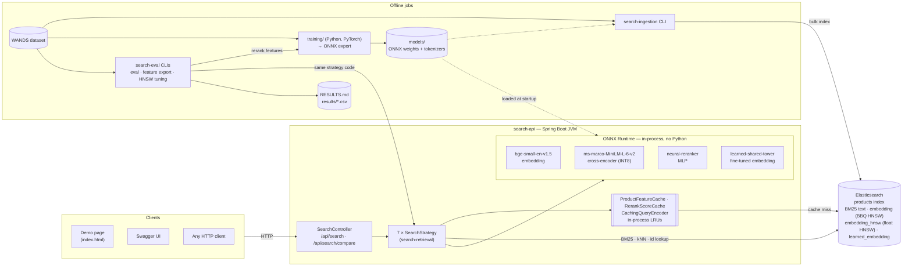
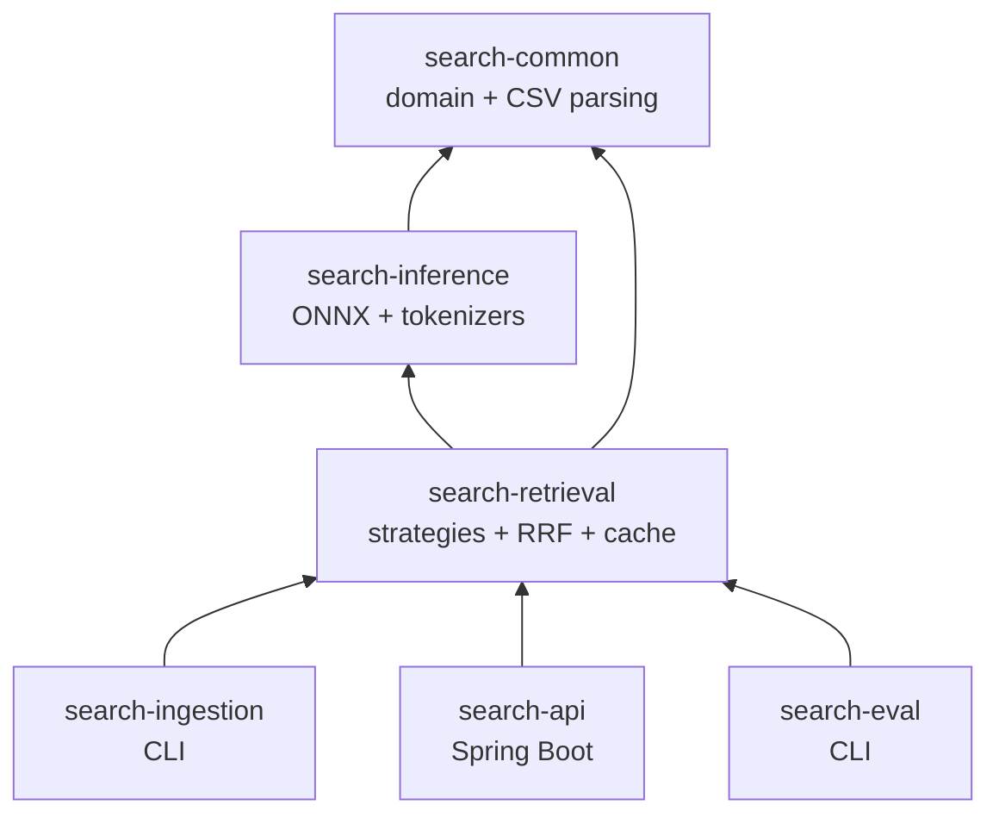
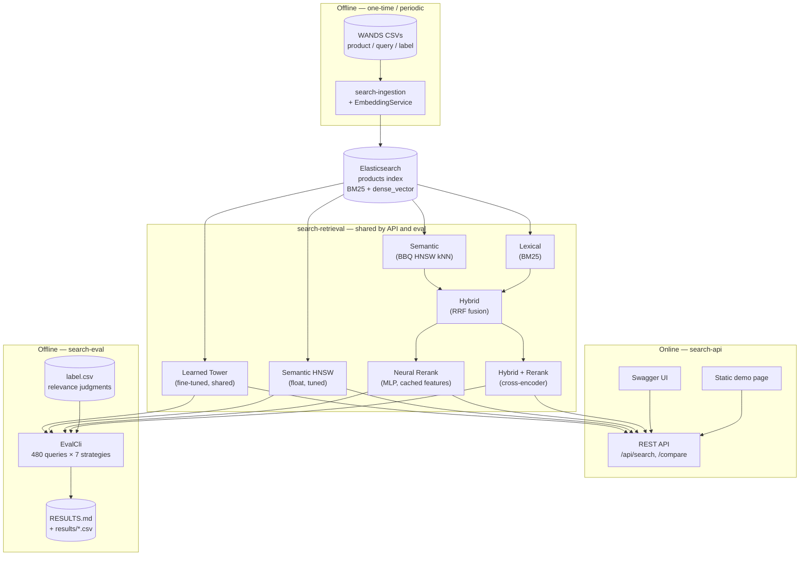
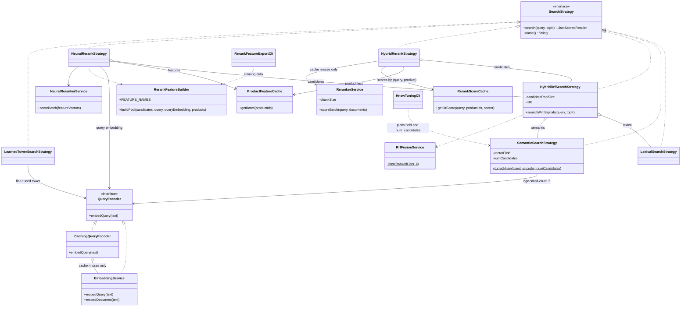
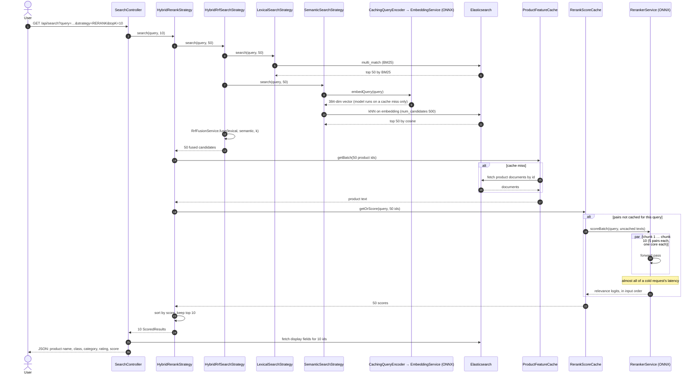
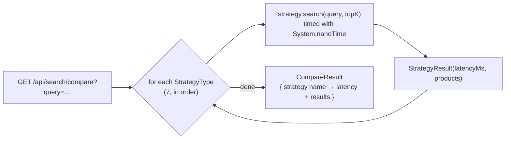
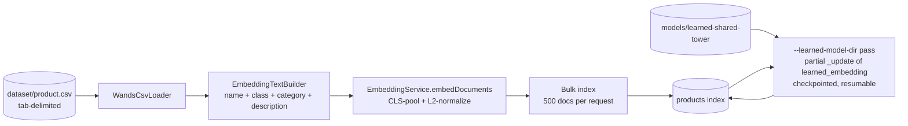

# Architecture

System architecture, module layout, data flow, class design, request
flows, the seven ranking strategies, the key design decisions behind them, and
implementation details worth knowing before you read the code.

| Diagram | Shows |
|---|---|
| [System architecture](#system-architecture) | Runtime components, where each model runs, offline vs. online paths |
| [Module dependencies](#module-layout) | How the six Maven modules depend on each other |
| [Data flow](#data-flow) | Catalog → index → strategies → API and eval |
| [Design](#design) | The `SearchStrategy` interface, its seven implementations, and what each composes |
| [Request flows](#request-flows) | A reranked search request, a `/compare` request, and catalog ingestion, step by step |

## System architecture



The online path is one JVM plus Elasticsearch. All four models run inside
the JVM through ONNX Runtime, so there is no network hop to a model server.
Python appears only in the offline training jobs, which write ONNX files
that the JVM loads. In Docker Compose, `search-api` and `elasticsearch` are
separate containers, and `models/` is mounted read-only into `search-api`.

## Module layout

Six-module Maven reactor:

```
search/
├── search-common/      domain models + WANDS CSV parsing (no framework deps)
├── search-inference/   ONNX Runtime + tokenizer wrappers — embedding & reranker services
├── search-retrieval/   Elasticsearch client + 6 pluggable SearchStrategy impls + RRF fusion
├── search-ingestion/   CLI: index creation + bulk indexing with embeddings
├── search-api/         thin Spring Boot REST API over search-retrieval
└── search-eval/        CLI: offline IR evaluation harness against label.csv
```



Arrows point from a module to the modules it depends on. Only `search-api`
depends on Spring; the other five are plain Java.

## Data flow

`search-retrieval` is framework-agnostic and shared by both `search-api` and
`search-eval`, so the evaluation harness scores the *exact same* strategy code
the API serves — no risk of eval measuring something different from
production:



## The seven ranking strategies

Each a `SearchStrategy` implementation:

1. **Lexical** — BM25 (`multi_match` across name/class/category/description/features)
2. **Semantic** — approximate kNN over `bge-small-en-v1.5` embeddings in the
   `embedding` field: HNSW over 1-bit quantized vectors (BBQ, Elasticsearch's
   default for 384 dims), `num_candidates` 500
3. **Semantic HNSW (float, tuned)** — the same embeddings in the
   `embedding_hnsw` field: float HNSW with m=32, ef_construction=200, and
   `num_candidates` 500, chosen by `HnswTuningCli` against exact kNN
4. **Hybrid** — client-side RRF fusion of Lexical and Semantic
5. **Hybrid + Rerank** — top-50 from Hybrid, rescored by the cross-encoder, top-10 returned
6. **Neural Rerank** — top-50 from Hybrid, rescored by a small MLP
   (trained with a LambdaRank loss) over 17 cheap, mostly-cached features:
   each candidate's lexical and semantic rank and score, embedding cosine
   similarity, query-term matches per product field, and rating signals.
   No transformer pass
7. **Learned Tower** — dense kNN search over `bge-small-en-v1.5` fine-tuned
   on WANDS itself, with one shared encoder for both queries and products

`HybridRerankStrategy` and `NeuralRerankStrategy` share one in-process
`ProductFeatureCache` (an LRU keyed by product id), so neither fetches
candidate data from Elasticsearch on every request. Semantic, Semantic
HNSW, Hybrid, and Neural Rerank share one `CachingQueryEncoder`, so a
request embeds its query once: Neural Rerank needs the query embedding
both inside Hybrid's semantic retrieval and for its cosine feature, and
`/compare` runs four strategies that embed the same query.

## Design

Every ranking approach is one implementation of a single interface. The
composite strategies (Hybrid and the two rerankers) wrap other strategies
instead of repeating their logic, so each stage builds on the one before it:



Design choices this structure supports:

- **One interface, many consumers.** `SearchController` holds a
  `Map<StrategyType, SearchStrategy>`, and `EvalCli` iterates the same
  strategies. A new strategy is one class plus one Spring bean; the API,
  the `/compare` endpoint, and the eval harness pick it up with no other
  change.
- **Composition over inheritance.** Hybrid takes any two strategies, and both
  rerankers take any candidate strategy. Each piece is unit-testable with
  fakes, and pool size and `k` are constructor arguments, so the eval
  harness can sweep them.
- **Inference behind small services.** Strategies depend on
  `QueryEncoder`, `RerankerService`, and `NeuralRerankerService`, not on
  ONNX Runtime directly. `CachingQueryEncoder` decorates `EmbeddingService`
  behind the same interface, so no strategy knows whether a vector came
  from the cache. The fine-tuned tower reuses `EmbeddingService`
  unchanged, because it keeps the same tensor contract.
- **Framework-free core.** Only `search-api` uses Spring. `SearchConfig`
  wires the plain-Java strategies as beans; `search-eval` and
  `search-ingestion` construct the same classes directly.

## Request flows

### A reranked search — `GET /api/search?strategy=RERANK`



The other strategies follow the same path with fewer steps. Lexical,
Semantic, and Learned Tower are one Elasticsearch query each (the two
embedding strategies first encode the query). Neural Rerank follows the
reranked path, but replaces the cross-encoder call with
`RerankFeatureBuilder` + `NeuralRerankerService`, which score 17 numbers
per candidate instead of reading the full text.

### Side-by-side comparison — `GET /api/search/compare`



Strategies run one after another, so each `latencyMs` is that strategy's
own cost, and the total response time is roughly their sum (dominated by
the cross-encoder). The demo page renders this response.

### Catalog ingestion — `search-ingestion`



The first pass creates the index (`--recreate` drops it first) and writes the
text fields and the `embedding` vector. The second pass adds
`learned_embedding` for Learned Tower without a full reindex.

## Reading the results

[RESULTS.md](RESULTS.md) has the full table. In summary:

- **Lexical → Semantic → Hybrid → Hybrid + Rerank** each improves nDCG@10
  over the one before it. Semantic alone has lower Recall@50 than Lexical;
  Hybrid fusion recovers that recall, because the two retrievers make
  different kinds of mistakes.
- **The cross-encoder reranker** has the best nDCG@10, but its MRR and
  Precision@10 are slightly below Hybrid's, and it is the slowest strategy
  (224 ms p95). Scoring a 50-candidate pool means 50 (query, document)
  transformer passes, so it costs much more than a single-pair benchmark
  suggests; see [Implementation notes](#implementation-notes) for how
  parallel chunking brought this down from ~1.5 s.
- **Neural Rerank** gets most of the cross-encoder's gain at a small part
  of its cost. On the same 96 held-out queries (the same-query table in
  RESULTS.md), it lifts nDCG@10 from 0.7468 (Hybrid) to 0.7730, against
  0.7798 for the cross-encoder — 79% of the cross-encoder's gain — and has
  the best Precision@10 of any strategy (0.9073). Its p95 is 10 ms
  against 224 ms. Its
  row in the main table is on the held-out queries only, which score
  higher than the full set for every strategy, so compare it in the
  same-query table.
- **Semantic HNSW (float, tuned)** is almost exact (0.986 recall@50
  against brute-force kNN, against 0.921 for the default BBQ index), but
  its nDCG@10 (0.6973) is close to Semantic's (0.6958) and to exact kNN's
  (0.6983). The approximate index is not what limits semantic quality; the
  embedding model is.
- **Learned Tower** scores below the off-the-shelf `bge-small-en-v1.5`.
  5,404 triplets over 2 epochs is little task-specific data compared to the
  model's original pretraining. The shared-encoder mode outscores a
  two-tower mode (separate query and product encoders) on every metric;
  two-tower has twice the trainable parameters on the same data.

Neural Rerank is the best quality per millisecond. Learned Tower stays in
eval, the API, and the demo as a measured result with a known cause. See
[TRAINING.md](TRAINING.md) for how both are trained.

## Key decisions

| Decision | Choice | Why |
|---|---|---|
| Dataset | [WANDS](https://github.com/wayfair/WANDS) — Wayfair furniture catalog | Ships with `product.csv`, `query.csv`, and `label.csv` (human relevance judgments: Exact/Partial/Irrelevant), which is what makes real IR metrics possible instead of a "looks reasonable" demo. |
| Stack | Java, embeddings + reranking run in-process via **ONNX Runtime** | No Python inference server anywhere — a deliberate differentiator, since most semantic-search portfolios are Python end to end. |
| Search engine | **Elasticsearch** | OpenSearch's native RRF fusion is open-source, while Elasticsearch's is Platinum-gated. This project fuses client-side in Java (see below), so that licensing difference does not apply. The free/Basic Elasticsearch license covers everything needed here (BM25 + `dense_vector`/kNN). |
| Hybrid fusion | Hand-rolled Reciprocal Rank Fusion (RRF) in Java, not a built-in engine endpoint | More demoable and independently unit-testable than flipping a config flag — it's the artifact that proves understanding of the algorithm, and it gives the eval harness full control to sweep the RRF constant. |
| Embedding model | `BAAI/bge-small-en-v1.5` (384-dim), via pre-exported ONNX weights from `Xenova/bge-small-en-v1.5` | Purpose-built for retrieval, small, and requires no local Python export step. Unlike most sentence-embedding models, BGE is trained with CLS-token pooling (first token of `last_hidden_state`) rather than mean pooling, and needs an asymmetric instruction prefix on queries only, not documents — both easy to get wrong silently since a mean-pooled embedding still "works," just worse; documented in `EmbeddingService`. |
| Reranker | `cross-encoder/ms-marco-MiniLM-L-6-v2`, via `Xenova/ms-marco-MiniLM-L-6-v2`'s **INT8-quantized** ONNX export | Standard MS MARCO cross-encoder. Scoring a 50-candidate pool means 50 (query, document) transformer passes; INT8 roughly halves the fp32 export's cost. That is a much heavier workload than the embedding model's batch-of-1 query encode, so the reranker uses the INT8 export and the embedding model stays fp32 (quantizing it would change every stored vector). |
| Neural reranker training | Features exported from Java (`RerankFeatureExportCli`), MLP trained in Python with a LambdaRank loss | One feature implementation means no training/serving skew: the model trains on the exact pools and values it serves. LambdaRank optimizes ranking order directly, weighted toward the top of the list. |
| Vector index | Default 1-bit BBQ HNSW for Semantic (and Hybrid); a second, float HNSW field (m=32, ef_construction=200, num_candidates 500) for Semantic HNSW | `HnswTuningCli` measured each vector type and graph setting against exact kNN. BBQ never passes 0.924 recall@50; float m=32 reaches 0.986 at num_candidates 500. Both are kept so the eval shows that higher recall barely changes nDCG@10. |
| Tokenization in Java | `ai.djl.huggingface:tokenizers` (standalone, not the full DJL engine) | The one piece Java lacks natively — loads `tokenizer.json` directly via JNI binding to the Rust `tokenizers` library, paired with raw ONNX Runtime for the forward pass. |
| Build tool | Maven, multi-module reactor | Declarative XML dependency graphs are easy for a reviewer to skim; no build-script logic to audit. |

## Implementation notes

WANDS files have a `.csv` extension but are **tab-delimited**, and the
category column is named `category hierarchy` (space, not underscore).
`WandsCsvLoader` parses accordingly. Category values have inconsistent
whitespace around `/` (e.g. `"Furniture / Beds"` vs `"Furniture/Beds"`), so
`EmbeddingTextBuilder` normalizes with a regex; a plain string replace
produces double-spaced text.

`product_features` (pipe-delimited attribute:value pairs) is indexed as a
separate lexical field but deliberately excluded from the embedding text —
attribute noise dilutes sentence-embedding quality more than it helps.

`search-eval` computes metrics for all 480 queries concurrently, but
measures p95 latency serially, one query at a time, over a fixed
100-query sample, after 5 warm-up queries. A concurrent burst would measure queueing delay behind the other
queries, not single-query latency — a large distortion for the reranker.
`RerankerService` pins its ONNX session to a single intra-op thread and
gates concurrent forward passes with a semaphore sized to the core count,
so concurrent API requests share the CPU instead of each spawning a
full-width thread pool. To keep a lone request from using only one core,
it splits the 50-pair batch into chunks of 5 (`search.reranker.chunk-size`)
and runs them in parallel on virtual threads, each chunk through the same
semaphore. Smaller chunks also pad to their own longest pair rather than
the whole batch's. Measured on 30 sequential WANDS queries (10-core
machine):

| Chunk size | p50 | p95 |
|---|---|---|
| 50 (one forward pass) | 2584 ms | 2855 ms |
| 25 | 1235 ms | 1336 ms |
| 10 | 525 ms | 569 ms |
| **5 (default)** | **330 ms** | **418 ms** |

`RerankScoreCache` then makes repeated queries almost free: it caches
cross-encoder scores by (normalized query, product id), and only uncached
candidates reach the model. The same 30 queries sent a second time return
in 19 ms p50 / 29 ms p95. Normalization (trim, collapse whitespace,
lowercase) doesn't change scores, because the reranker's tokenizer is
uncased. `search-eval` disables this cache, so its latency numbers always
measure the model. The model uses dynamic INT8 quantization (scales
computed per forward pass), so a pair's exact score can shift slightly with
chunk boundaries. A full-eval A/B on the same index shows ranking quality
is unchanged (`--reranker-chunk-size` selects the chunk size):

| Reranker | nDCG@10 | MRR | Precision@10 | Eval p95 |
|---|---|---|---|---|
| One pass of 50 | 0.7456 | 0.9043 | 0.8377 | 1479 ms |
| Chunks of 5, in parallel | 0.7450 | 0.9034 | 0.8388 | 258–449 ms |

`CachingQueryEncoder` (an LRU keyed by normalized query text) sits in
front of the embedding model. Neural Rerank needs the query embedding
twice per request (inside Hybrid's semantic retrieval, and for its cosine
feature), and `/compare` runs four strategies that embed the same query.
With the cache the model runs once per request. A cached encode saves
about 4–5 ms (p50 9.1 → 4.7 ms for a Semantic request, 30 WANDS queries
through the API). `search-eval` uses a cache of size 1: it measures
latency one query at a time, so the cache removes only the repeat encode
inside a request and never serves a hit across queries.

### HNSW tuning

Elasticsearch indexes a 384-dimension `dense_vector` as BBQ HNSW by
default: an HNSW graph over 1-bit quantized vectors, with 3x
oversampling and float rescoring. `HnswTuningCli` measures whether that is
good enough. It loads all 42,994 vectors, computes each query's exact
top-50 neighbors by brute force in Java, then builds a scratch index (one
segment) per configuration and runs all 480 queries at each
`num_candidates` value. Selected rows (full sweep:
`results/hnsw-sweep.csv`):

| Vector type, graph | num_candidates | Recall@10 vs exact | Recall@50 vs exact | nDCG@10 | Index size |
|---|---|---|---|---|---|
| BBQ (1-bit), m=16, ef_construction=100 — default | 500 | 0.968 | 0.921 | 0.6951 | 71 MB |
| BBQ (1-bit), m=16, ef_construction=100 — default | 1000 | 0.974 | 0.924 | 0.6956 | 71 MB |
| int8, m=16, ef_construction=100 | 500 | 0.961 | 0.965 | 0.6930 | 86 MB |
| float, m=16, ef_construction=100 | 500 | 0.974 | 0.970 | 0.6931 | 69 MB |
| float, m=16, ef_construction=100 | 1000 | 0.982 | 0.982 | 0.6948 | 69 MB |
| **float, m=32, ef_construction=200 (served)** | **500** | **0.987** | **0.986** | **0.6987** | 69 MB |
| Exact kNN (brute force) | — | 1 | 1 | 0.6983 | — |

What the sweep shows:

- **Quantization caps recall.** BBQ never passes 0.924 recall@50 at any
  `num_candidates`; the 1-bit error is larger than what more graph search
  recovers. int8 sits between BBQ and float.
- **A denser graph beats a wider search.** m=32/ef_construction=200
  reaches 0.986 at 500 candidates; m=16 needs 1000 to pass 0.98. It costs
  more build time, not more index size.
- **Latency doesn't separate the settings at this size.** Every setting
  answers in 0.8–1.5 ms p50 and 1.2–2.8 ms p95 (mostly request overhead),
  against 5.3 ms p95 for brute-force `script_score`, a gap that grows with
  catalog size. The tool therefore picks the fewest
  `num_candidates` that reaches 98% recall@50, not the lowest latency.
- **Index size doesn't drop with quantization here.** Elasticsearch keeps
  the float vectors for rescoring, so BBQ and int8 add to the float size
  on disk; their saving is memory during graph search.
- **Recall is not the quality bottleneck.** Exact kNN scores 0.6983
  nDCG@10, so no index setting can lift Semantic much. A better embedding
  model would.

In the served `products` index, BBQ Semantic scores 0.6958 and tuned float
HNSW 0.6973 — the same order as the sweep.

The RRF constant sweep fetches each query's lexical and semantic candidate
lists once and reuses them for every swept `k`, since re-fusing at a
different `k` is pure in-memory arithmetic.

The cross-encoder needs enough CPU. On Colima's default 2-CPU VM, a single
forward pass can starve the same container's outbound Elasticsearch call
past its 1s connect timeout, which surfaces as an intermittent 500 on
`strategy=RERANK`. [HOWTO.md](HOWTO.md) gives the VM size to use.

## See also

- [RESULTS.md](RESULTS.md) — the current evaluation numbers
- [TRAINING.md](TRAINING.md) — the two custom-trained models
- [CI.md](CI.md) — the CI pipeline and security posture
- [HOWTO.md](HOWTO.md) — running it locally
